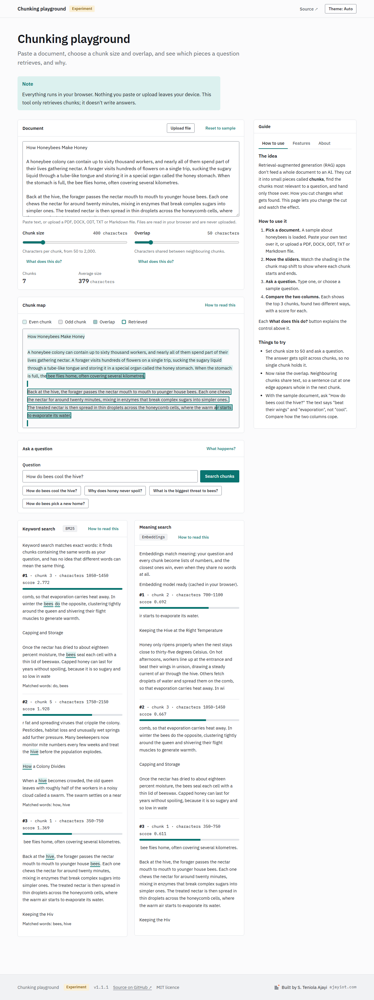

# Chunking playground

> Paste a document, change the chunk size and overlap, ask a question, and see exactly which chunks get retrieved and why.



**Live demo:** _coming soon (GitHub Pages)_

Most RAG tutorials hide chunking behind a default setting. This playground makes that step visible: split a real document, compare keyword search (BM25) with meaning-based search (embeddings) side by side, and see the score behind every result.

Everything runs in your browser. No server, no API key.

## Features

- Paste any document (a sample is preloaded), or upload a PDF, DOCX, ODT, TXT or Markdown file
- Chunk size and overlap sliders, in characters
- Chunk map: the document shaded by chunk, with overlaps in a third shade
- Chunk stats: total count and average size
- Ask a question, get the top 3 chunks from each retrieval mode
- Keyword (BM25) vs. meaning (embeddings), with scores and matched-word highlighting
- Plain-English note under each mode explaining why it matched

- A guide panel beside the app (How to use, Features, About), which becomes a drawer on mobile
- A `?` hint on every control

Retrieval only: there is deliberately no answer-generation step, so no LLM is needed. Not supported: legacy `.doc` files and scanned PDFs (no OCR).

## Stack

- [Vite](https://vite.dev) + vanilla JS, HTML and CSS
- The Ninth design system (copied into `public/ninth/`) with IBM Plex Sans and Mono
- [`@huggingface/transformers`](https://github.com/huggingface/transformers.js) running `Xenova/all-MiniLM-L6-v2` (about 23 MB, downloaded once, then cached)
- Hand-written chunker, BM25, cosine similarity and DOCX/ODT text extraction
- [pdf.js](https://mozilla.github.io/pdf.js/) and [fflate](https://github.com/101arrowz/fflate), loaded only when a file is uploaded
- GitHub Actions deploying to GitHub Pages

## Getting started

```bash
pnpm install
pnpm dev
```

Build for production:

```bash
pnpm build
```

## Project status

Version 1.1.2 (see [CHANGELOG.md](CHANGELOG.md)). See [CONTRIBUTING.md](CONTRIBUTING.md) if you'd like to help.

## Credits

Made by [S. Teniola Ajayi](https://ajayiot.com). Styled with Ninth; the IBM Plex fonts are under the SIL Open Font License (see [public/ninth/fonts/OFL.txt](public/ninth/fonts/OFL.txt)).

## License

[MIT](LICENSE) © S. Teniola Ajayi
